# A tour of BirdGate

What BirdGate is, why it exists, and how it works, page by page. The app
screenshots come from the explorer in this repository running on the Sierra
Nevada soundscapes: 33 hours of annotated recordings and 56 species. To run it
yourself, see [Run the app](README.md#run-the-app). It starts from the bundled
demo data in under a minute.

**Contents.** [What this is](#what-this-is) · [1 Honest evaluation](#1-honest-evaluation) ·
[2 How much silence is there?](#2-how-much-silence-is-there) · [3 The ceiling first](#3-the-ceiling-first) ·
[4 The audio maths](#4-the-audio-maths) · [5 Four approaches, head to head](#5-four-approaches-head-to-head) ·
[6 Will it fit on the chip?](#6-will-it-fit-on-the-chip) · [7 Put it on your AudioMoth](#7-put-it-on-your-audiomoth) ·
[Where next](#where-next)

---

## What this is

Passive acoustic monitoring is heading towards very large numbers of small,
cheap, low-power recorders, left in forests and on moors for months at a time.
Most of the effort in bioacoustic AI goes into large models such as BirdNET and
Perch, which can name hundreds of species but run afterwards, on a server, over
everything the recorders captured.

There is a lot of work left at the other end of the scale: very small,
almost insect-level intelligence that does one small job on the device itself,
every second, robustly and on a battery. BirdGate is one such job. An AudioMoth
records everything it hears, and at most sites most of that is wind, rain and
silence. BirdGate is a model of a few hundred bytes that decides, one second at
a time, whether there is birdsong worth writing to the card.

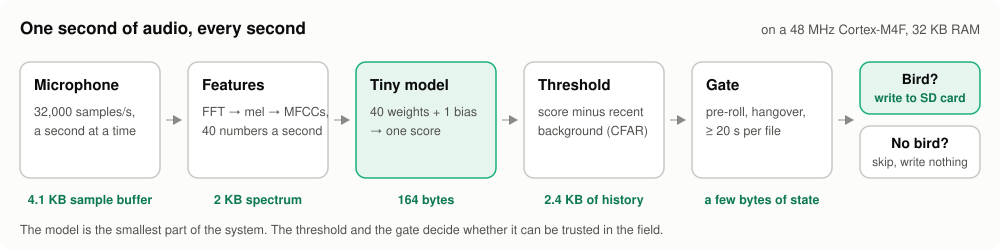

The model is the smallest part of the system. What makes it trustworthy is around
it. The **adaptive threshold** compares each score with the recent background,
so one setting works in a quiet hour and a rainy one. The **gate** keeps a
second of audio before each call, holds the file open after it, and writes files
long enough to listen to.

Four ways of hearing were compared under identical conditions:

> [!NOTE]
> **Work in progress: these are preliminary results.** Every model was trained
> and tested on one dataset: 33 hours from one area of the Sierra Nevada, all
> recorded in May 2018, with 21 recordings for training, six for tuning and six
> held out. The CNN figures come from a single training run of a network that has
> had little tuning, and it could improve substantially with more varied data and
> better training. Treat the comparison as where things stand today, not a verdict
> on which approach is best. Retraining on Highland recordings is planned.

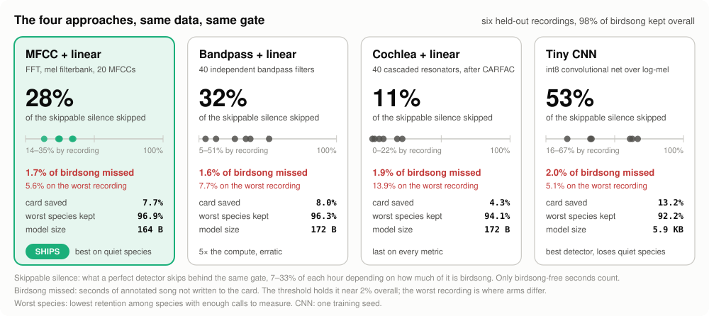

How much card a gate can save depends mostly on the site: an hour that is 90%
birdsong has little silence to skip, and an hour that is 10% birdsong has a lot.
So each card splits the result into what the approach got right and what it got
wrong. The headline is the share of the *skippable* silence it skipped, where
skippable is what a perfect detector skips behind the same gate; only seconds with
no birdsong count. The dots show it on each of the six held-out recordings. In
red is the birdsong it threw away: about 2% overall for every approach, because
the threshold is set to keep 98%, so the worst single recording is where they
differ.

The CNN is the best detector but loses more of the quietest species. That
metric decides what ships, for the reason given in chapter 5. And all four are
tiny:

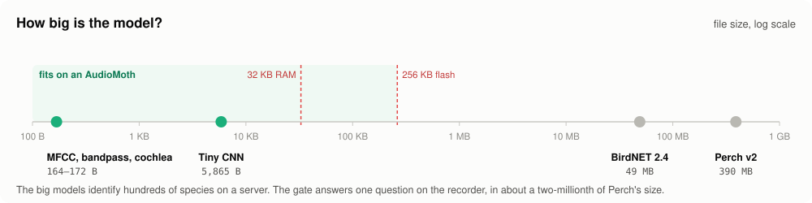

The rest of the tour follows the app's tabs. Numbered red markers in each
screenshot match the numbered notes below it.

---

## 1. Honest evaluation

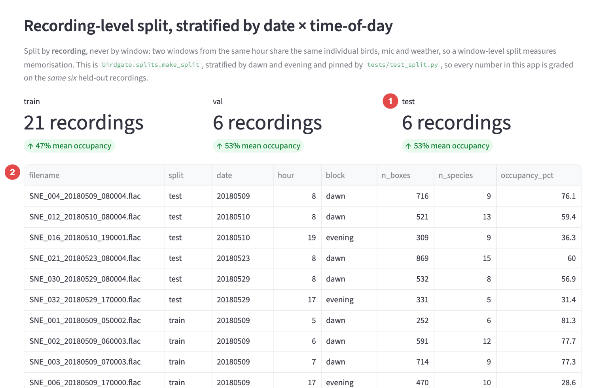

1. **Six recordings are held out** and never touched in training or tuning.
   Every result in the tour is measured on them.
2. **The split is by recording, never by second.** Two seconds from the same
   hour share the same birds, microphone and weather, so a model tested on
   seconds from hours it trained on is being tested on memory. The split also
   balances dawn and evening sessions, and a test pins it so it cannot drift.

---

## 2. How much silence is there?

A gate can only save the silence that exists, so the first question is how much
there is and what shape it comes in.

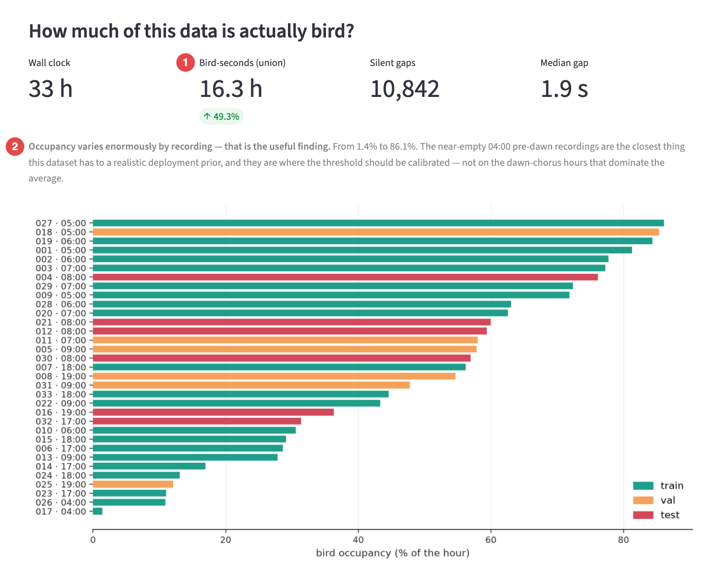

1. **Birdsong fills 16.3 of the 33 hours**, about half.
2. **That varies enormously by recording**, from 1.4% in a pre-dawn hour to 86.1%
   at the height of the dawn chorus. The near-empty hours look most like a real
   long-term deployment, where a gate is most useful.

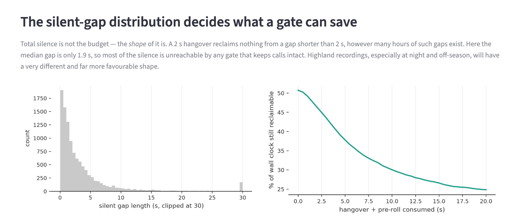

The *shape* of the silence matters more than the total. The median gap between
calls is 1.9 seconds, and a gate that keeps calls whole cannot reclaim a gap
shorter than the time it waits before closing. Most of this dataset's silence is
out of reach of any gate. Sparser sites have far longer gaps.

---

## 3. The ceiling first

Before training any model, the real gate was driven with *perfect* scores: the
annotations themselves. Whatever that saves is the most any model can save with
these settings.

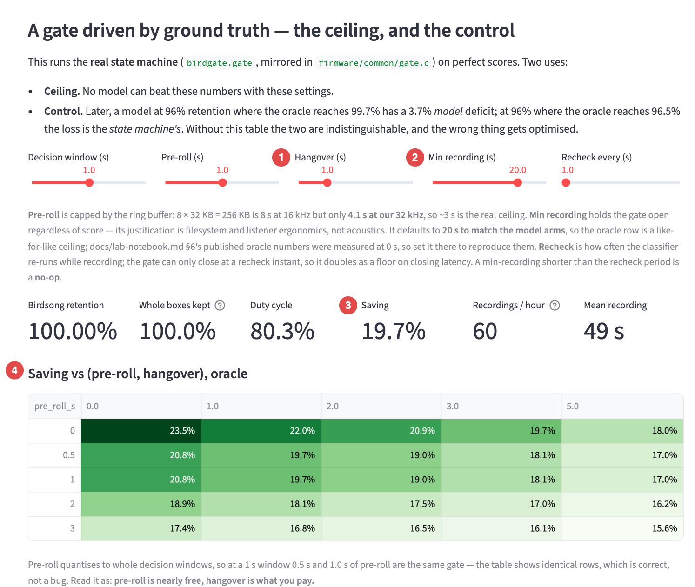

1. **Hangover** keeps the file open after the last call, so trailing notes are
   not cut off.
2. **Minimum recording** keeps each file open for at least 20 seconds. This is
   for the listener and the filesystem, not the acoustics: fewer, longer files.
3. **The ceiling.** Even a perfect detector saves only 19.7% of the card here,
   because the silence comes in short gaps.
4. **What each setting costs.** Saving falls as pre-roll (rows) and hangover
   (columns) grow. Read it as: *pre-roll is nearly free; hangover is what you
   pay*.

This step also exposed a measurement trap. Keeping 99.7% of birdsong *seconds*
sounds excellent, but at that level 8.3% of whole calls were being clipped.
Counting whole calls became a headline metric.

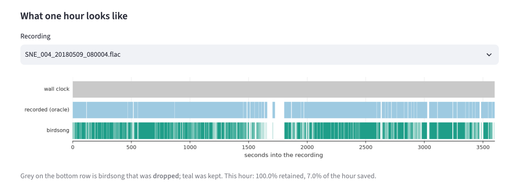

One hour, second by second: grey is birdsong, teal is what was kept, and blue is
what was written to the card.

---

## 4. The audio maths

Every approach turns one second of sound into a short list of numbers. They
differ in how they get there, and on a 48 MHz microcontroller that difference
is the whole budget.

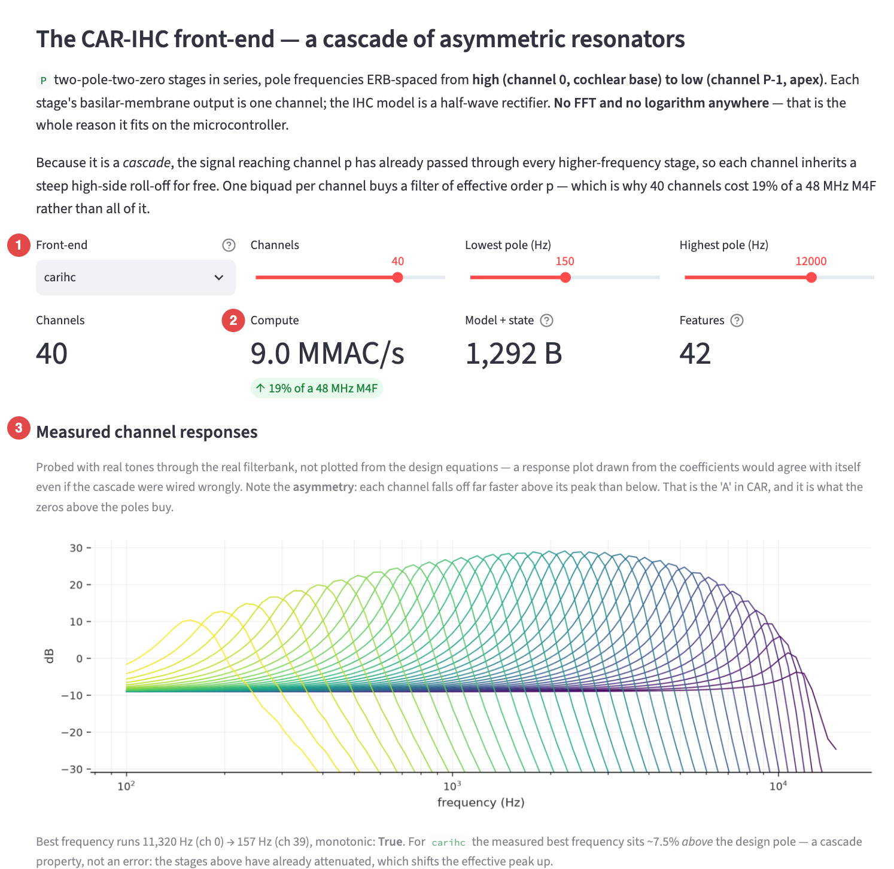

1. **Pick a front-end.** `carihc` is a model cochlea: 40 resonators in a cascade,
   after Richard Lyon's CARFAC, each filtering the output of the one before.
   `bands` is the same 40 channels as independent bandpass filters, the control
   that isolates the cascade. `mfcc` takes the FFT route.
2. **Compute.** The cochlea needs 9.0 million multiply-accumulates a second, 19% of
   the processor.
3. **The channel responses**, measured by playing tones through the real
   filterbank rather than drawn from the design equations. Each channel falls off
   much faster above its peak than below. That asymmetry is the "A" in CAR.

The surprise is cost. A filter cascade does its work on every *sample*: 32,000 a
second, times 40 channels. An FFT does its work once per *frame*: 100 a second.
At the 8 kHz sample rate common in this field the filters are cheaper, which is
the usual argument for cochlear front-ends on microcontrollers. At 32 kHz,
needed here for high, thin calls such as kinglets and goldcrests, the argument
inverts, and MFCC runs about **5× cheaper** than the cascade.

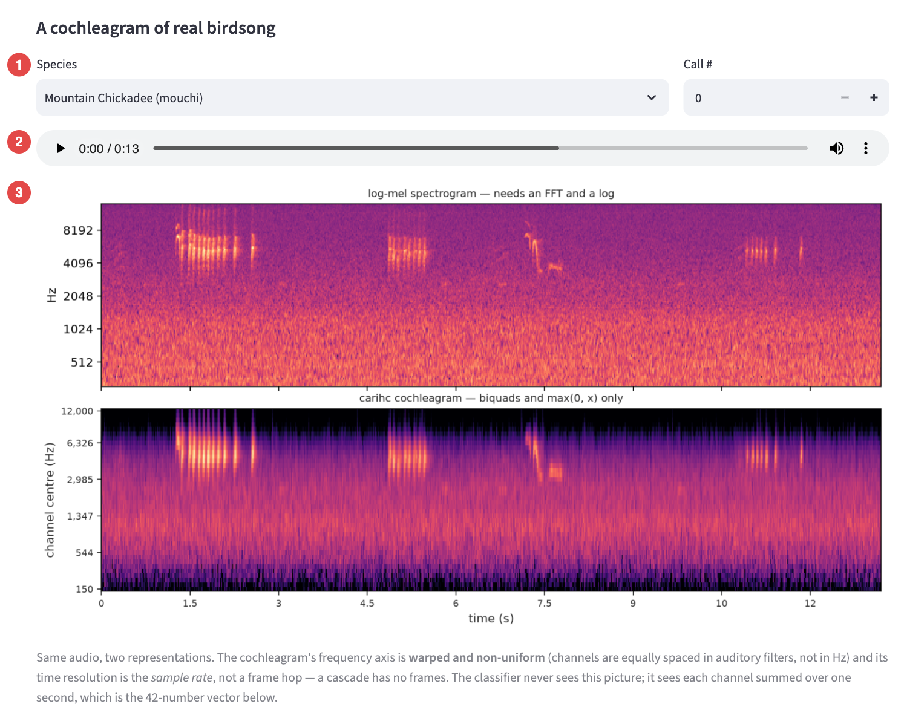

1. **Pick a species.**
2. **Listen to the call.**
3. **The same audio, two ways:** a log-mel spectrogram, which needs an FFT and a
   logarithm, and the cochleagram, which needs only filters and a rectifier. The
   model sees neither picture. It sees each channel summed over the second, about
   40 numbers.

The cochlea is elegant, physically motivated and validated to machine precision,
and it loses: last on every metric, at the highest compute cost.
[SUMMARY.md, Appendix A](SUMMARY.md#appendix-a--the-three-linear-arms-in-detail)
works through the filter mathematics.

---

## 5. Four approaches, head to head

This tab runs every approach over one hour with the same gate and threshold
rule, and shows what each would have kept and what it would have lost for good.

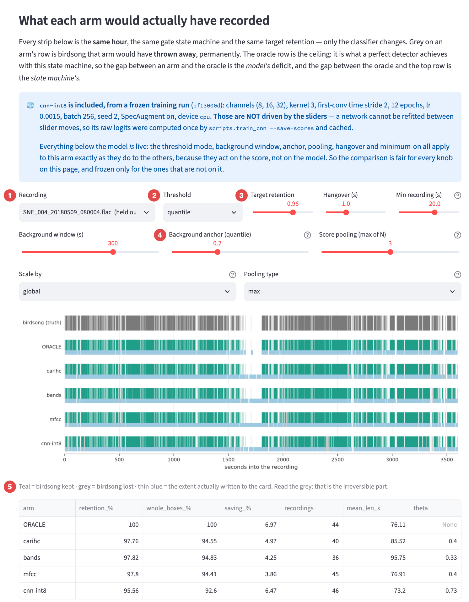

1. **Recording.** Held-out recordings are listed first.
2. **Threshold mode.** `fixed` is one absolute threshold everywhere. It looks fine
   on average and fails silently: across recordings, retention ranged from
   54.9% to 99.3%. `quantile` is CFAR, borrowed from radar. It compares the score
   with a trailing estimate of the background, which collapses that 44-point
   spread to under 5.
3. **Target retention.** The threshold is chosen on the validation recordings to
   hit this, then applied here unchanged, never tuned on the hour being shown.
4. **The background anchor**, the most consequential number in the system. At 0.2
   the gate is a detector and records about 5% of pure silence. At 0.5 the same
   code becomes a duty-cycle controller and records about 75% of it.
5. **How to read it.** Grey on an approach's row is birdsong it threw away, which
   can never be recovered.

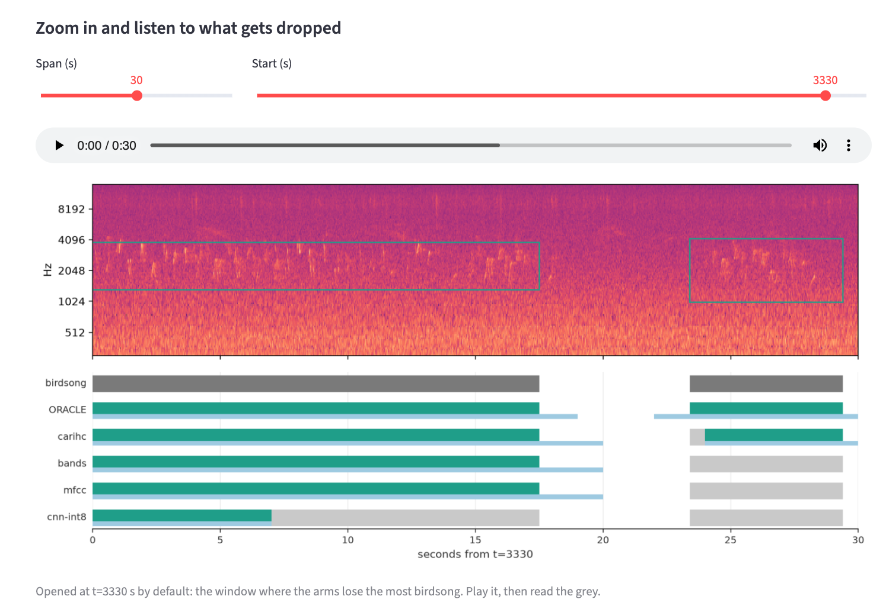

Zoom in, listen, and read the grey. In this window of a held-out dawn recording,
the CNN drops a stretch of song that all three linear models keep.

**Why the best detector does not ship.** At matched retention the CNN skips 53% of
the skippable silence against MFCC's 28%. But a gate that keeps 99% of a loud, common
species and 45% of a quiet one has built a species bias into every analysis
those recordings will ever support. Nobody can detect it later, because the audio
is gone. So the deciding metric is the *worst* species, and on that MFCC is
ahead. For a rewilding project the quiet, rare, returning species is often the
point.

---

## 6. Will it fit on the chip?

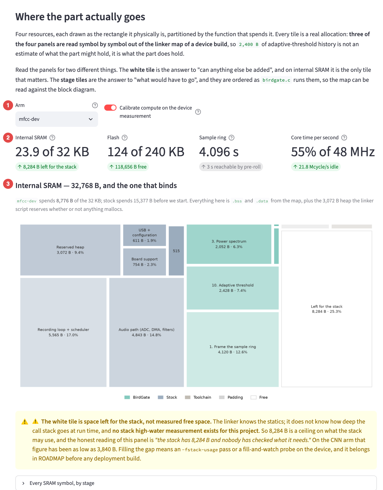

1. **Pick a firmware build**: `mfcc-dev`, `cnn`, or stock AudioMoth for
   comparison.
2. **Internal SRAM is the resource that binds.** The AudioMoth's 32 KB is shared
   with the stock firmware, which uses 15 KB before BirdGate starts.
3. **Every tile is a real allocation**, read symbol by symbol from the linker map
   of an actual device build, not estimated. BirdGate's own share is the teal:
   4 KB to frame the audio, 2 KB of spectrum and 2.4 KB of threshold history.

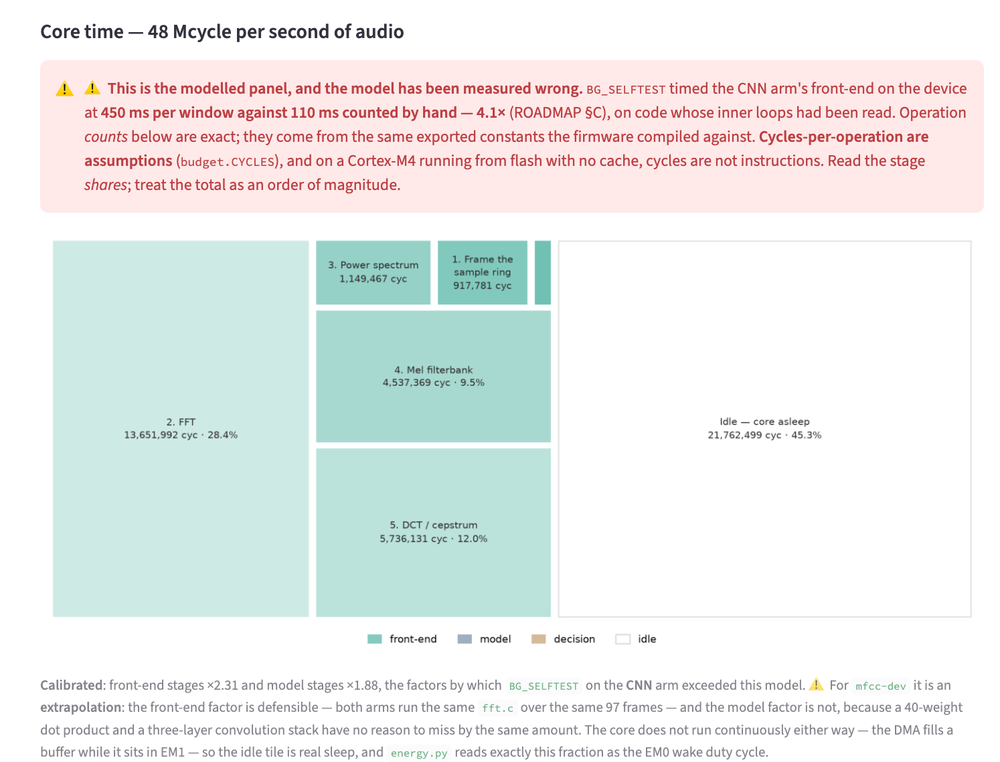

Compute is the one panel that is modelled rather than measured, and it says so.
On the device, the self-timing build measured the CNN at **790 ms per one-second
window**: inside the budget, but only after the hot loops were rewritten. The MFCC
build has not been timed on the device yet.

---

## 7. Put it on your AudioMoth

The firmware is the same chain in C, checked against the Python on real audio:
over 15 minutes of the busiest recording, the two make the same record-or-skip
decision every second.

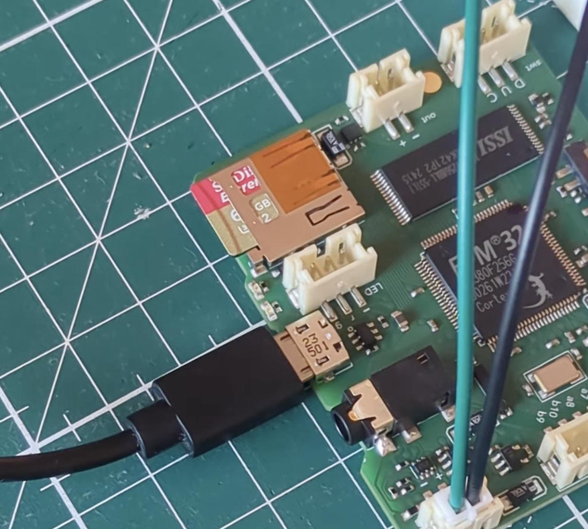

**What you need:** an AudioMoth 1.x, a micro-USB cable, an SD card, three AA
cells, and the Open Acoustic Devices
[Flash and Configuration apps](https://www.openacousticdevices.info/applications).

**What the current build does:** it runs the detector live and **lights the green
LED for each second it hears birdsong**. It does not yet write gated audio to the
card; that is the next firmware step.

1. **Get the firmware.** Download `birdgate-mfcc-dev.bin` from the latest
   [release](https://github.com/donora/BirdGate/releases), or build it with
   `./firmware/build.sh mfcc-dev`. Building needs the
   `gcc-arm-none-eabi-10.3-2021.10` toolchain and two upstream clones;
   [firmware/README.md](firmware/README.md) has the details, including the
   C-against-Python parity test to run before flashing.
2. **Configure the device** in the Configuration App: sample rate 32 kHz, one
   recording period covering the whole day, LED on, and the amplitude and
   frequency triggers off.
3. **Flash it.** Put the device in USB/OFF, open the Flash App, choose the
   `.bin`, and flash. The stock release binary is your way back.

   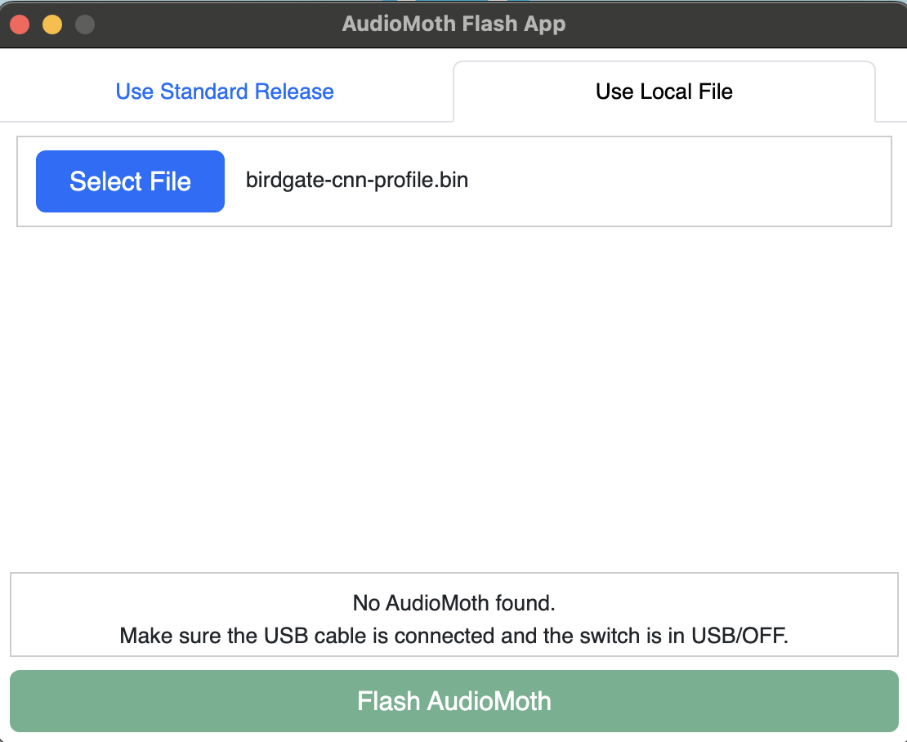

4. **Watch it.** Switch to CUSTOM. The **green LED** lights for each second
   scored as birdsong and goes out on the first second that is not. If the red
   LED blinks fast and the green stays dark, the sample rate is not 32 kHz and the
   detector is not running. A red LED that comes on and stays on means the
   detector fell behind real time at least once.

   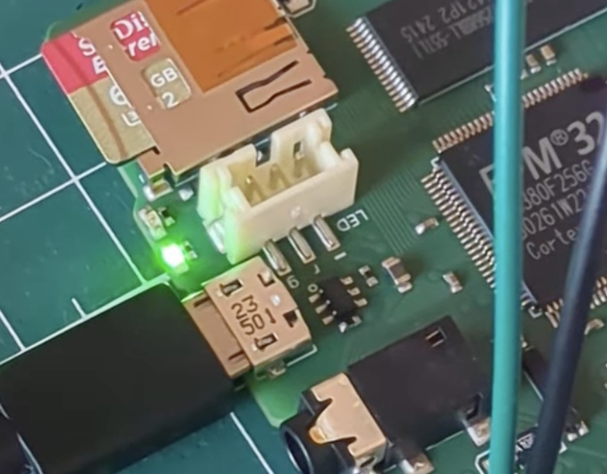

Two things to expect, both the adaptive threshold working as designed. Start it
somewhere quiet, because the background estimate is seeded from the first
second. And a recording played through a speaker with gaps between takes will set
it off on the background, because no field recording has silences like that.
[firmware/README.md](firmware/README.md) has the bench-testing protocol.

---

## Where next

- **Write to the card.** Gated recording with pre-roll, then a before-and-after
  pair you can listen to.
- **Measure the energy** on the bench, to turn the energy model's estimates into
  deployment days.
- **A side-by-side field trial:** one stock recorder and one gated, 24 hours,
  same spot.
- **Highland recordings.** Retrain on the target site. Only the training set and
  the threshold change; everything else carries over.

[ROADMAP.md](ROADMAP.md) has the order and the reasoning.
[SUMMARY.md](SUMMARY.md) has every finding in full, and the
[lab notebook](docs/lab-notebook.md) has every experiment behind them.
